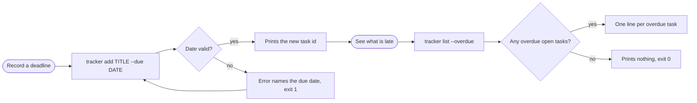

# UX Flow: `002 — Due dates and overdue tasks`

- Specification: [`specification.md`](specification.md)
- Surface: the `tracker` CLI (`add`, `list`, `list --overdue`)

Required because this Standard-route task changes a human-facing interaction (the CLI). It was shown at the checkpoint with the specification.

## User path

## States

| Screen or command | State | What the user sees or gets | Criterion |
| --- | --- | --- | --- |
| `tracker add --due` | loading | n/a: the command completes immediately | n/a |
| `tracker add --due` | error | A message naming the due date on stderr; exit code 1; nothing stored | AC-3 |
| `tracker add --due` | success | The new task id; the task later lists with `(due 2026-12-01)` | AC-2 |
| `tracker list --overdue` | empty | No output; exit code 0 | AC-8 |
| `tracker list --overdue` | success | Only open tasks due before today (UTC), one per line | AC-6, AC-7 |
| `tracker list` | success | Tasks without a due date print exactly the current line format | AC-11 |

## Reuse

- Existing components or commands reused: the line format `[ ] <id> <title>` from `src/tracker/cli.py`, extended with ` (due <date>)`; the existing `--db` option and exit-code convention.
- New components: none.

## Accessibility and usability

- `tracker add --help` and `tracker list --help` describe `--due` and `--overdue`, including the date format.
- Error messages name the problem and the expected format, so the user can correct the command without reading the documentation.
