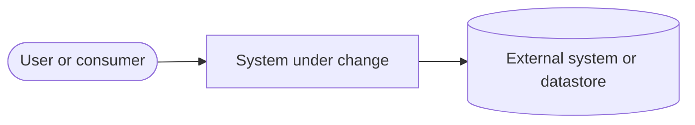
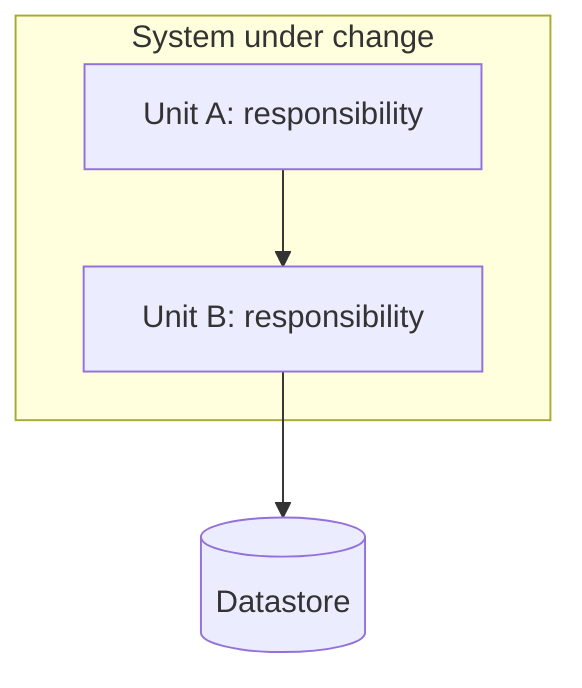

# Architecture: `<TASK_ID> — <TITLE>`

- Specification: `<path>`
- Related ADRs: `<paths or none>`

Required on Full routes, and on Standard routes when a new module or unit is added or boundaries between units change. Write it before the checkpoint and summarize it there. Keep it to what reviewers need; decisions with real alternatives go into ADRs.

## Scope and context

What changes, which units and external systems take part, and which constraints apply.

C4 level 1 (context): people and systems around the change.

## Building blocks

C4 level 2 (containers): deployable or independently built units and their dependency direction. Mark new and changed units.

## Runtime notes

- `<important interactions, ordering, failure handling, retries, or timeouts>`

## Deployment and operations

- `<deployment order, configuration, migration sequencing, rollback, monitoring signals>`

## Risks and technical debt

- `<risk>` — `<mitigation or accepted reason>`

## Decisions

| Decision | ADR |
| --- | --- |
| `<decision>` | `<path or none (no real alternative)>` |
