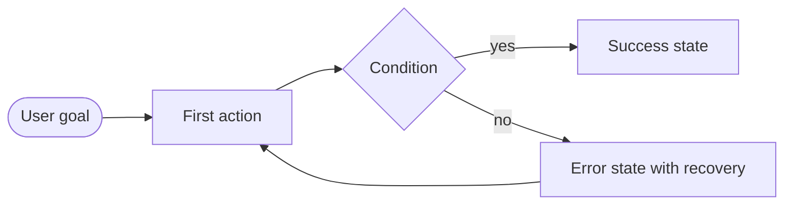

# UX Flow: `<TASK_ID> — <TITLE>`

- Specification: `<path>`
- Surface: `<screen, page, CLI command, or other human-facing interaction>`

Required on Standard and Full routes when a human-facing interaction changes. Write it before the checkpoint and show it there.

## User path

Replace the nodes with the real path. Keep one diagram per user story that changes.

## States

| Screen or command | State | What the user sees or gets | Criterion |
| --- | --- | --- | --- |
| `<name>` | loading | `<feedback while waiting, or n/a>` | `<AC-ID>` |
| `<name>` | empty | `<what appears when there is no data>` | `<AC-ID>` |
| `<name>` | error | `<message and how to recover>` | `<AC-ID>` |
| `<name>` | success | `<result>` | `<AC-ID>` |

Add other states the surface has (partial, offline, permission denied). A state with no criterion is a gap in the specification.

## Reuse

- Existing components or commands reused: `<paths from the capability map's design system entry>`
- New components: `<none, or the component and a link to its justification in the specification's Decisions>`

## Accessibility and usability

- `<keyboard access, focus order, labels, contrast, messages, or CLI help text as relevant>`
